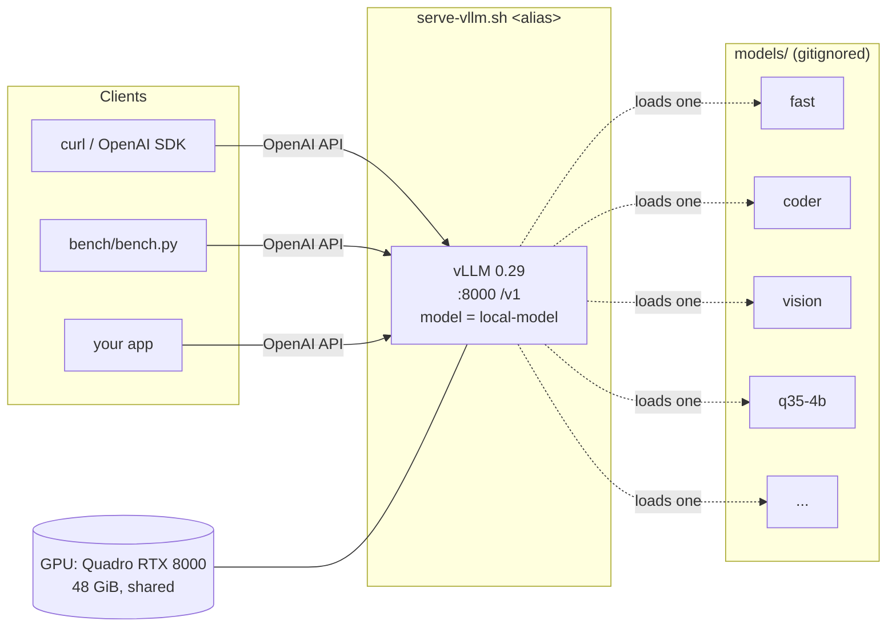
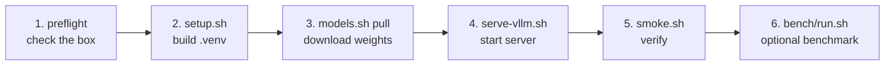
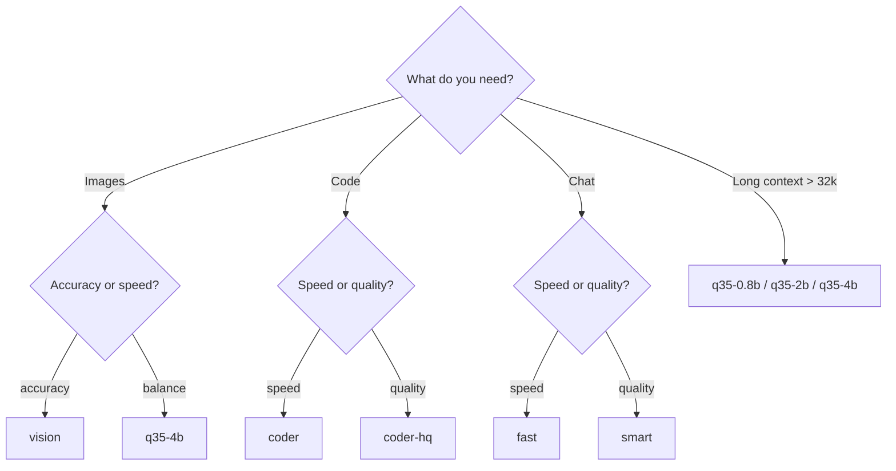
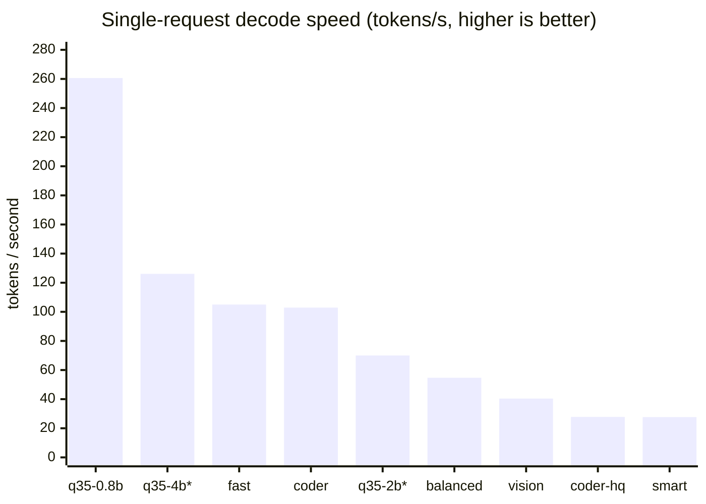
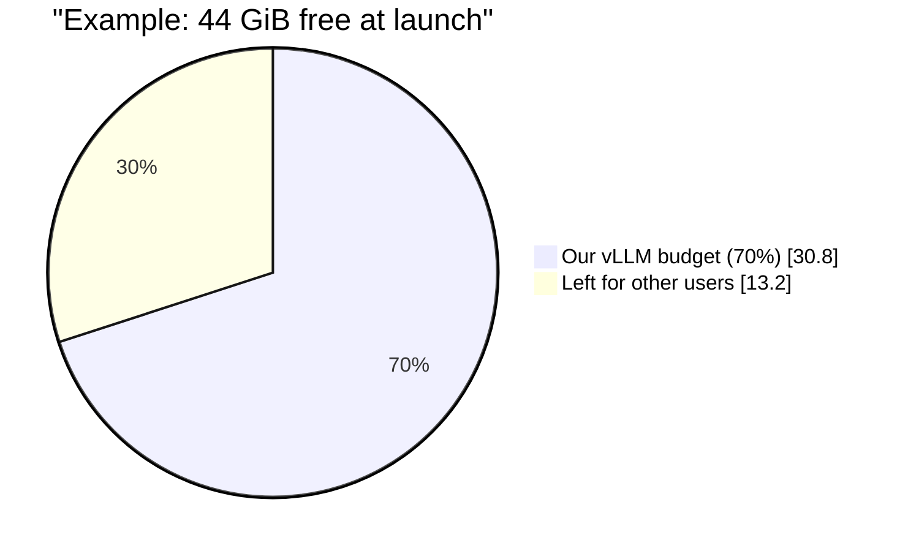

<div align="center">

# Light_LLM

**A self-hosted, OpenAI-compatible LLM server for a shared Quadro RTX 8000**

Nine Qwen models (chat, code, vision, reasoning), one command to serve any of them,
a benchmark suite, and resource caps so it never starves other users of the GPU.


[Quickstart](#-quickstart) · [Full setup](#-full-setup-from-a-fresh-clone) · [Use the API](#-calling-the-server) · [Models](#-model-catalog) · [Results](#-benchmark-results) · [Troubleshooting](#-troubleshooting)

</div>

---

## 📌 What this is

Any OpenAI client can point at `http://127.0.0.1:8000/v1` and talk to a local model called
**`local-model`**. Which checkpoint answers is decided at launch by an *alias* (`fast`,
`coder`, `vision`, …), so downstream code never changes when you swap models.



Everything lives inside the project folder: weights in `models/`, HuggingFace cache in
`.hf/`, compiled kernels in `.vllm-cache/`, and the Python env in `.venv/`. Deleting the
folder removes all of it. Nothing touches `~/.bashrc` or `~/.cache`.

---

## ⚡ Quickstart

Already set up on the lab machine (`.venv/` and `models/` exist)? Then:

```bash
cd ~/Desktop/Shrouk/LLMS2       # or wherever the project lives
bash scripts/serve-vllm.sh fast  # terminal 1: start serving (Ctrl-C to stop)
bash scripts/smoke.sh            # terminal 2: proves it answers -> "smoke: PASS"
```

Then call it:

```bash
curl -s http://127.0.0.1:8000/v1/chat/completions -H 'Content-Type: application/json' -d '{
  "model": "local-model",
  "messages": [{"role": "user", "content": "Say hello in three languages."}]
}' | python3 -m json.tool
```

Starting from a fresh clone? Follow the full setup below.

---

## 🛠 Full setup (from a fresh clone)



### Prerequisites

| Need | Version used | Check with |
|---|---|---|
| Linux + NVIDIA GPU | Quadro RTX 8000, compute capability 7.5 | `nvidia-smi` |
| NVIDIA driver | ≥ 580 (for CUDA 13 wheels) | `nvidia-smi` |
| [`uv`](https://docs.astral.sh/uv/) | 0.12.x | `uv --version` |
| Python | 3.12 (uv can fetch it) | `python3 --version` |
| Disk | ~85 GiB for all nine models, ~8 GiB for the venv | `df -h .` |

No conda, Docker, or sudo is required. `nvcc` is not needed.

### Step 1: Clone and run the preflight check

```bash
git clone https://github.com/Shrouk21/Light_LLM.git
cd Light_LLM
bash scripts/preflight.sh .     # read-only; installs and changes nothing
```

It reports the GPU, driver, RAM, disk, tooling and network. It should end with `0 blocking`.
A `download.pytorch.org (403)` failure is a [known false alarm](#-troubleshooting).

### Step 2: Create the Python environment

```bash
bash scripts/setup.sh
```

This creates `.venv/` with Python 3.12 and installs the exact pinned package set from
[`requirements.lock.txt`](requirements.lock.txt) (vLLM 0.29.0, torch 2.13.0, transformers
5.17.0, huggingface-hub 1.32.0, and their dependencies). It takes about 10 minutes and
~8 GB of disk. It ends by printing `cuda ok: True`.

### Step 3: Download a model

```bash
bash scripts/models.sh verify      # every catalog repo resolves and is ungated
bash scripts/models.sh list        # catalog + how much context fits on the GPU *right now*
bash scripts/models.sh pull fast   # ~5.2 GiB; repeat for any alias you want
```

`list` marks downloaded models with `*`. Downloads run at about 12 MB/s without a token.
`export HF_TOKEN=hf_...` before pulling raises HuggingFace's rate limit. All repos are public,
so the token is optional.

### Step 4: Serve it

```bash
bash scripts/serve-vllm.sh fast
```

Before launching, the script prints its plan: free GPU memory, the budget it will take,
the CPU cores it pins to, the RAM cap, and a **predicted KV-cache size**. vLLM then logs its
own `GPU KV cache size: N tokens`. If the two disagree, trust the log and fix
`scripts/catalog.sh`.

The server is ready when the log shows `Application startup complete`. Startup takes 10–30 s
for Qwen2.5 models. Qwen3.5 (`q35-*`) models take 2.5–3.5 min the **first** time while Triton
compiles kernels, and about 15 s after that.

### Step 5: Verify

```bash
bash scripts/smoke.sh            # health, model name, a completion, streaming
bash scripts/smoke.sh --think    # q35-* only: also checks thinking mode
bash scripts/watch.sh            # live GPU / KV-cache / tok/s / who-else-is-on-the-GPU
```

### Step 6 (optional): Benchmark it

```bash
bash bench/run.sh fast           # quality (40 prompts) + load test at 1/4/8 concurrency
python3 bench/summary.py         # one-row-per-model markdown table
python3 bench/report.py          # regenerates RESULTS.md with every question and answer
```

### Stopping the server

Press Ctrl-C in its terminal, or run:

```bash
pkill -INT -f "[v]llm serve"     # the [v] stops pkill from matching your own shell
```

---

## 🔌 Calling the server

The API is the standard OpenAI one: `/v1/chat/completions`, `/v1/completions`,
`/v1/models`, plus `/health` and `/metrics`. The model name is always `local-model`.

**Python (OpenAI SDK).** `pip install openai` in your own environment, then:

```python
from openai import OpenAI

client = OpenAI(base_url="http://127.0.0.1:8000/v1", api_key="unused")  # or your LLM_API_KEY
r = client.chat.completions.create(
    model="local-model",
    messages=[{"role": "user", "content": "Write a haiku about GPUs."}],
    extra_body={"chat_template_kwargs": {"enable_thinking": False}},  # matters for q35-* only
)
print(r.choices[0].message.content)
```

**Images** (`vision`, `q35-*` aliases):

```python
import base64
img = base64.b64encode(open("bench/images/v10_bar_chart_B.png", "rb").read()).decode()
r = client.chat.completions.create(model="local-model", messages=[{"role": "user", "content": [
    {"type": "image_url", "image_url": {"url": f"data:image/png;base64,{img}"}},
    {"type": "text", "text": "Which bar is tallest?"}]}])
```

**Thinking mode** (`q35-*` aliases): send `"chat_template_kwargs": {"enable_thinking": true}`.
The answer arrives in `content` and the chain of thought in `reasoning_content`.
Qwen3.5 **thinks by default**, so send `false` for normal chat. Thinking runs need a large
`max_tokens` (8k+); see [results](#-benchmark-results) for why it rarely pays off at these sizes.

### Server options

All are environment variables set on the `serve-vllm.sh` command line:

| Variable | Default | Effect |
|---|---|---|
| `HOST` | `127.0.0.1` | `0.0.0.0` exposes the server to the network |
| `PORT` | `8000` | listen port |
| `LLM_API_KEY` | *(none)* | require `Authorization: Bearer <key>`; `smoke.sh` and the bench send it automatically |
| `RESOURCE_PCT` | `70` | share of *free* GPU memory, CPU cores and RAM to take |
| `GPU_RESERVE_MIB` | `4096` | always leave at least this much VRAM free for others |

Extra arguments are passed straight to `vllm serve`, for example
`bash scripts/serve-vllm.sh fast --max-model-len 8192`.

Example: `HOST=0.0.0.0 LLM_API_KEY=secret RESOURCE_PCT=50 bash scripts/serve-vllm.sh coder`.

---

## 🧠 Model catalog

The source of truth is [`scripts/catalog.sh`](scripts/catalog.sh). Every size is the real
summed file size from the HuggingFace API, and every repo is ungated.

| Alias | Repository | Weights | Max context | Good for |
|---|---|---|---|---|
| `fast` | `Qwen/Qwen2.5-7B-Instruct-AWQ` | 5.19 GiB | 32k | 💬 chat: fast default |
| `coder` | `Qwen/Qwen2.5-Coder-7B-Instruct-AWQ` | 5.19 GiB | 32k | 💻 code |
| `balanced` | `Qwen/Qwen2.5-14B-Instruct-AWQ` | 9.29 GiB | 32k | 💬 chat |
| `smart` | `Qwen/Qwen2.5-32B-Instruct-AWQ` | 18.00 GiB | 32k | 💬 chat: highest quality |
| `coder-hq` | `Qwen/Qwen2.5-Coder-32B-Instruct-AWQ` | 18.00 GiB | 32k | 💻 code: highest quality |
| `vision` | `Qwen/Qwen2.5-VL-7B-Instruct` | 15.45 GiB | 32k | 🖼 images (best vision score) |
| `q35-0.8b` | `Qwen/Qwen3.5-0.8B` | 1.63 GiB | 131k | 🖼 💬 🤔 fastest, tiny |
| `q35-2b` | `cyankiwi/Qwen3.5-2B-AWQ-4bit` | 2.33 GiB | 131k | 🖼 💬 🤔 |
| `q35-4b` | `cyankiwi/Qwen3.5-4B-AWQ-4bit` | 3.76 GiB | 65k | 🖼 💬 🤔 good all-rounder |

🤔 = supports thinking mode. `serve-vllm.sh` applies each model's required flags for you:
`--dtype float16` everywhere, `--reasoning-parser qwen3` for `q35-*`, and an image limit for `vision`.

**Which one should I use?**



**Adding a model:** append a row to `CATALOG` in `scripts/catalog.sh`
(`alias|repo|weights_gib|kv_per_tok_kib|max_model_len|lanes|notes|extra_args`), run
`models.sh verify`, `pull`, then `serve-vllm.sh`. Compare the predicted KV with what vLLM logs,
and correct `kv_per_tok_kib` if they differ.

---

## 📊 Benchmark results

All nine models were measured on 2026-09-27 with the 70% resource cap.
**[RESULTS.md](RESULTS.md)** has every question and every model's answer.


<sub>\* measured while another user's ~16 GiB job shared the GPU, so the real speed is higher.</sub>

| Alias | Chat | Code | Reasoning | Reasoning + think | Vision | TTFT | tok/s (1 req) | tok/s (8 conc.) |
|---|---|---|---|---|---|---|---|---|
| `fast` | 10/10 | 10/10 | 9/10 | — | — | 26 ms | 105.0 | 733.9 |
| `coder` | 10/10 | 10/10 | 9/10 | — | — | 25 ms | 102.9 | 712.9 |
| `balanced` | 10/10 | 10/10 | 9/10 | — | — | 45 ms | 54.7 | 361.8 |
| `smart` | 10/10 | 10/10 | 9/10 | — | — | 87 ms | 27.7 | 191.5 |
| `coder-hq` | 10/10 | 10/10 | 9/10 | — | — | 87 ms | 27.8 | 191.8 |
| `vision` | 10/10 | 10/10 | 9/10 | — | **10/10** | 92 ms | 40.4 | 292.8 |
| `q35-0.8b` | 10/10 | 10/10 | 9/10 | 1/10 | 6/10 | 23 ms | **260.6** | **1596.1** |
| `q35-2b` ⚠ | 9/10 | 10/10 | 8/10 | 5/10 | 8/10 | 102 ms | 70.0 | 507.8 |
| `q35-4b` ⚠ | 10/10 | 10/10 | 9/10 | 2/10 | 9/10 | 147 ms | 126.1 | 761.8 |

**What the numbers say**

- **The chat, code and reasoning prompts are too easy to rank models.** Every model scores
  9–10/10. They prove each model serves correct output, not that a 32B beats a 7B.
  Harder prompts are the obvious next step.
- **Vision separates the models:** `vision` 10 > `q35-4b` 9 > `q35-2b` 8 > `q35-0.8b` 6.
  The misses are text reading (`HELLO 42` read as `h110`) and charts.
- **Thinking mode does not pay off at these sizes.** With an 8192-token budget most runs never
  finished thinking. With thinking off, the same models score 8–9/10.
- **Every model fails r08** ("10 days after Monday"; the answer is Thursday).
- ⚠ rows shared the GPU with another job, so their speeds are understated and their scores are unaffected.
  Re-run `bench/run.sh q35-2b` / `q35-4b` on a quiet card for clean numbers.

---

## 🧮 How resources are shared

This is a **shared lab server**: 25+ users and one GPU. Every server takes at most
`RESOURCE_PCT` (default **70%**) of what is *free at launch*, not of the total:

| Resource | Rule | Enforced by |
|---|---|---|
| GPU memory | `min(70% × free, free − GPU_RESERVE_MIB)` | `--gpu-memory-utilization` |
| CPU | first 70% of cores (0–21 of 32) | `taskset` |
| RAM | 70% of currently available | `systemd-run --user --scope -p MemoryMax=` |



- vLLM counts **other users' memory against our share**. If someone allocates during startup,
  our KV cache shrinks. That is the safe direction, but you get less context than predicted.
- If less than 4 GiB of budget is available, `serve-vllm.sh` refuses to start and lists who is on
  the GPU.
- `OMP_NUM_THREADS` is deliberately **not** set. vLLM already uses one thread per worker, and setting it would *increase* CPU use.

---

## 🖥 Hardware notes: why the flags look the way they do

| | |
|---|---|
| GPU | Quadro RTX 8000, 49152 MiB, **compute capability 7.5 (Turing)** |
| Driver / CUDA | 580.159.03 / CUDA 13.0 runtime (nvcc 12.0, unused) |
| CPU / RAM | i9-14900K, 32 threads / 125 GiB |
| Python / tooling | 3.12.3, `uv` 0.12.17, no conda |

Turing is old. Most 2026 tutorials assume features this card lacks. Each item below was checked
against the installed vLLM:

| Feature | On sm_75 | Consequence |
|---|---|---|
| `bfloat16` | ❌ | everything runs `--dtype float16` |
| fp8 KV cache | ❌ | KV is fp16 (2 bytes/element), so context costs 2× what newer cards pay |
| **Marlin int4/int8 GEMM** | ✅ | AWQ/GPTQ int4 models run on fast kernels, which is why most of the catalog is AWQ |
| FlashAttention-2 | ❌ | vLLM falls back to Triton automatically |
| Qwen3.5 linear attention | ✅ (Triton fallback) | works, but the first start compiles kernels for ~2–3 min |

**Unverified:** Turing's 64 KiB shared memory per SM *may* limit vLLM to `head_dim ≤ 256`.
Every current model is within that limit, but check any new model with `head_dim` 512.
Also, swap on this box is nearly full because another user's Java process holds ~30 GiB of it,
while RAM is fine (~83 GiB available). Don't "fix" memory pressure that isn't there.

### There is also Ollama on this box

`ollama` runs as a system service on **`http://127.0.0.1:11434/v1`** (also OpenAI-compatible)
with 24 models other users pulled (`qwen2.5-coder:32b`, `deepseek-r1:32b`, `gemma4:26b`,
`qwen3.6:35b-a3b`, …). It holds 0 VRAM when idle, so the two stacks coexist.
**Check it before downloading anything** for one-off use. Use this project's vLLM server when you
need throughput under concurrent requests, where continuous batching is much faster.

---

## 📁 Repository layout

```
Light_LLM/
├── README.md                 you are here
├── RESULTS.md                generated: every benchmark question × every model
├── requirements.lock.txt     exact package versions (installed by setup.sh)
├── scripts/
│   ├── preflight.sh          read-only hardware/tooling check
│   ├── setup.sh              build .venv from the lockfile
│   ├── env.sh                project-scoped env vars + the 70% resource budget (sourced by all)
│   ├── catalog.sh            the model table (single source of truth)
│   ├── models.sh             verify | list | pull <alias>
│   ├── serve-vllm.sh         serve one alias on :8000 as "local-model"
│   ├── smoke.sh              end-to-end check of a running server
│   └── watch.sh              live GPU / KV / throughput / other-users monitor
├── bench/
│   ├── prompts/*.jsonl       40 prompts (chat, code, reasoning, vision) + answer regex
│   ├── images/               10 synthetic test images for the vision lane
│   ├── bench.py              quality + load benchmark (stdlib only)
│   ├── run.sh                bench.py wrapper; picks lanes from the catalog
│   ├── summary.py            newest result per alias -> markdown table
│   └── report.py             regenerates RESULTS.md
├── MODELS.md, local-model-research.md, scaffold-the-vllm-proud-wirth.md
│                             📜 historical planning docs, written for an 8 GB laptop GPU, not this machine
│
│   ── gitignored, created locally ──
├── .venv/                    Python env (~8 GB)
├── models/                   downloaded weights (~79 GB for all nine)
├── .hf/  .vllm-cache/        HuggingFace + compiled-kernel caches
├── logs/                     server and benchmark logs
└── bench/results/            raw benchmark JSONL
```

---

## 🩺 Troubleshooting

| Symptom | Cause / fix |
|---|---|
| `ERROR: only N MiB free on the GPU` | Someone else is using the card. Run `nvidia-smi` to see who, then wait, use a smaller alias, or lower `GPU_RESERVE_MIB` |
| `Refusing to start: only ~N tokens of KV would fit` | Model + KV doesn't fit the budget. Try a smaller alias or `--max-model-len 8192` |
| vLLM logs fewer KV tokens than predicted | Another user allocated during startup (see [resources](#-how-resources-are-shared)) |
| `Cannot use FA version 2 ... compute capability >= 8` | Harmless on Turing; vLLM falls back automatically |
| `FlashInfer top-p/top-k sampling unavailable` | Harmless; PyTorch sampler is used instead |
| `q35-*` takes minutes to start | First-run Triton compile, cached in `.vllm-cache/`. Renaming a `models/` folder triggers a recompile |
| `q35-*` gives empty `content` | It is still thinking. Send `enable_thinking: false` or raise `max_tokens` |
| `preflight.sh`: `download.pytorch.org` 403 | False alarm: only the bare root returns 403; the wheel indexes work |
| install dies with `Failed to acquire lock on the distribution cache` | Another uv install holds the cache; `UV_LOCK_TIMEOUT=1800 bash scripts/setup.sh` |
| `pkill -f "vllm serve"` killed my shell | Use `pkill -INT -f "[v]llm serve"` |
| `models.sh list` doesn't mark a model `*` | Download is incomplete (a shard is missing). Re-run `pull`; it resumes |
| `--swap-space` / `--disable-log-requests` unknown | Removed in vLLM 0.29. Flags in the historical docs are stale |

Server logs go to `logs/vllm-<alias>.log`.

---

## 🧭 Next steps for whoever picks this up

- [ ] **Harder benchmark prompts.** The current chat/code/reasoning sets can't separate models.
- [ ] Re-benchmark `q35-2b` and `q35-4b` on a quiet GPU for clean speed figures.
- [ ] Put a gateway (e.g. LiteLLM) in front to route by alias and to serve several models at once.
- [ ] Make the 1500 MiB activation allowance in the KV prediction model-dependent: too low for 32B models and `vision`.
- [ ] Evaluate larger models Ollama already proves run on this card (`qwen3.5:27b`, `qwen3.6:35b-a3b`) under vLLM.
