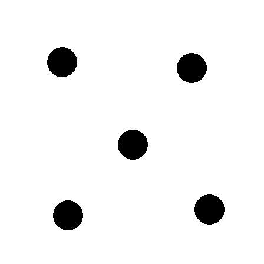
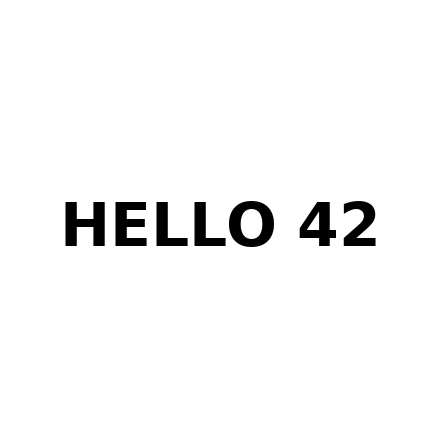
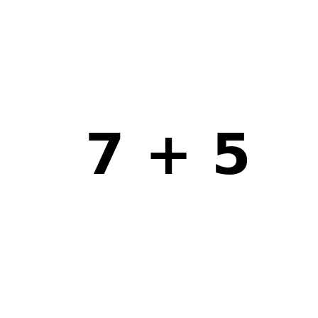
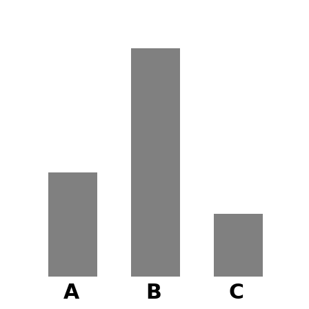

# Model benchmark results

*Generated by `python3 bench/report.py` on 2026-09-29 20:29. Do not edit by hand; re-run the script instead.*

Nine local models were served one at a time with vLLM and asked the same 40 questions. This page shows the overall scores, then every question with every model's answer.

## Setup

| | |
|---|---|
| GPU | Quadro RTX 8000, 48 GiB, compute capability 7.5 (Turing), shared lab machine |
| Engine | vLLM 0.29.0, one model at a time, served as `local-model` |
| Resource cap | 70% of the GPU memory free at launch, 22 of 32 CPU cores, 70% of available RAM |
| Runs | 2026-09-27 20:14 to 2026-09-27 22:09 |

**Method.** Each question is sent once at temperature 0 with thinking mode off, and the answer is scored by a regular expression (the *Expected* line under each question). The Qwen3.5 models answer the reasoning questions a second time with thinking on (8192-token budget, temperature 0.6, top_p 0.95). A load test then runs 256-token generations at 1, 4 and 8 concurrent requests.

| Model | Repository | Weights | Max context | Lanes |
|---|---|---|---|---|
| `fast` | `Qwen/Qwen2.5-7B-Instruct-AWQ` | 5.19 GiB | 32,768 | chat |
| `coder` | `Qwen/Qwen2.5-Coder-7B-Instruct-AWQ` | 5.19 GiB | 32,768 | code |
| `balanced` | `Qwen/Qwen2.5-14B-Instruct-AWQ` | 9.29 GiB | 32,768 | chat, think |
| `smart` | `Qwen/Qwen2.5-32B-Instruct-AWQ` | 18.00 GiB | 32,768 | chat, think |
| `coder-hq` | `Qwen/Qwen2.5-Coder-32B-Instruct-AWQ` | 18.00 GiB | 32,768 | code |
| `vision` | `Qwen/Qwen2.5-VL-7B-Instruct` | 15.45 GiB | 32,768 | vision, chat |
| `q35-0.8b` | `Qwen/Qwen3.5-0.8B` | 1.63 GiB | 131,072 | vision, chat, think |
| `q35-2b` | `cyankiwi/Qwen3.5-2B-AWQ-4bit` | 2.33 GiB | 131,072 | vision, chat, think |
| `q35-4b` | `cyankiwi/Qwen3.5-4B-AWQ-4bit` | 3.76 GiB | 65,536 | vision, chat, think |

## Scoreboard

| Alias | Chat | Code | Reasoning | Reasoning + think | Vision | TTFT | tok/s (1 req) | tok/s (8 conc.) | Peak GPU (card) | Other users |
|---|---|---|---|---|---|---|---|---|---|---|
| `fast` | 10/10 | 10/10 | 9/10 | — | — | 26 ms | 105.0 | 733.9 | 32.6 GiB | none |
| `coder` | 10/10 | 10/10 | 9/10 | — | — | 25 ms | 102.9 | 712.9 | 31.8 GiB | none |
| `balanced` | 10/10 | 10/10 | 9/10 | — | — | 45 ms | 54.7 | 361.8 | 31.3 GiB | none |
| `smart` | 10/10 | 10/10 | 9/10 | — | — | 87 ms | 27.7 | 191.5 | 31.3 GiB | none |
| `coder-hq` | 10/10 | 10/10 | 9/10 | — | — | 87 ms | 27.8 | 191.8 | 31.3 GiB | none |
| `vision` | 10/10 | 10/10 | 9/10 | — | 10/10 | 92 ms | 40.4 | 292.8 | 30.6 GiB | none |
| `q35-0.8b` | 10/10 | 10/10 | 9/10 | 1/10 | 6/10 | 23 ms | 260.6 | 1596.1 | 31.5 GiB | none |
| `q35-2b` | 9/10 | 10/10 | 8/10 | 5/10 | 8/10 | 102 ms | 70.0 | 507.8 | 31.4 GiB | 15.7 GiB ⚠ |
| `q35-4b` | 10/10 | 10/10 | 9/10 | 2/10 | 9/10 | 147 ms | 126.1 | 761.8 | 36.1 GiB | 16.0 GiB ⚠ |

*TTFT* is time to first token. *tok/s (1 req)* is the speed one user sees; *tok/s (8 conc.)* is total output with 8 requests at once. *Peak GPU* is the whole card, including other users.

⚠ **`q35-2b`, `q35-4b`**: measured while another user's job was on the GPU, so the speed figures are lower than the model's real speed. The scores are unaffected.

## Key findings

- **Chat: general knowledge:** best score 10/10, by all except `q35-2b`
- **Code:** best score 10/10, by every model
- **Reasoning, thinking off:** best score 9/10, by all except `q35-2b`
- **Reasoning, thinking on (Qwen3.5 models only):** best score 5/10, by `q35-2b`
- **Vision: synthetic images:** best score 10/10, by `vision`
- **Fastest for one request:** `q35-0.8b` at 260.6 tok/s
- **Most output with 8 concurrent requests:** `q35-0.8b` at 1596.1 tok/s
- **Every model got [r08](#reasoning-r08) wrong:** "If today is Monday, what day is it 10 days from now? One word at the end." Answers given: Monday, Sunday, Tuesday, Wednesday.
- **Thinking mode rarely finishes in 8192 tokens:** `q35-0.8b` 1/10 correct, 9 ran out of budget; `q35-2b` 5/10 correct, 5 ran out of budget; `q35-4b` 2/10 correct, 8 ran out of budget. With thinking off, the same models score 8–9/10.
- **The chat, code and reasoning questions are too easy to rank models.** Almost every model scores 9–10/10 on them. They show that each model serves correct output; only vision and speed separate the models.

## Memory and startup

Before launch, `serve-vllm.sh` predicts how many tokens of context (the KV cache) fit in the budget; vLLM then logs the real figure.

| Model | Predicted KV tokens | vLLM logged | Error | Concurrency at max context | Engine start |
|---|---|---|---|---|---|
| `fast` | 491,373 | 498,784 | -1.5% | 15.2× at 32,768 | 7.89 s |
| `coder` | 491,373 | 484,080 | +1.5% | 14.8× at 32,768 | 16.80 s |
| `balanced` | 120,928 | 116,464 | +3.8% | 3.5× at 32,768 | 22.56 s |
| `smart` | 55,020 | 51,424 | +7.0% | 1.6× at 32,768 | 26.89 s |
| `coder-hq` | 55,020 | 51,424 | +7.0% | 1.6× at 32,768 | 27.01 s |
| `vision` | 299,264 | 260,560 | +14.9% | 8.0× at 32,768 | 23.74 s |
| `q35-0.8b` | 1,736,078 | 2,410,769 | -28.0% | 18.4× at 131,072 | 159.63 s |
| `q35-2b` | 2,543,018 | 981,713 | +159.0% | 7.5× at 131,072 | 175.60 s |
| `q35-4b` | 432,870 | 453,248 | -4.5% | 6.9× at 65,536 | 199.42 s |

An error of a few percent is expected: the prediction allows a fixed 1.5 GB for activations. That is too little for the 32B models and for `vision`'s image encoder. Qwen3.5 models start slowly the first time they are served (kernel compilation), and in about 15 s after that.

## Results grid

✅ correct · ❌ wrong · — not run for this model

### Chat: general knowledge

| Case | `fast` | `coder` | `balanced` | `smart` | `coder-hq` | `vision` | `q35-0.8b` | `q35-2b` | `q35-4b` |
|---|---|---|---|---|---|---|---|---|---|
| [c01](#chat-c01) | ✅ | ✅ | ✅ | ✅ | ✅ | ✅ | ✅ | ✅ | ✅ |
| [c02](#chat-c02) | ✅ | ✅ | ✅ | ✅ | ✅ | ✅ | ✅ | ✅ | ✅ |
| [c03](#chat-c03) | ✅ | ✅ | ✅ | ✅ | ✅ | ✅ | ✅ | ✅ | ✅ |
| [c04](#chat-c04) | ✅ | ✅ | ✅ | ✅ | ✅ | ✅ | ✅ | ✅ | ✅ |
| [c05](#chat-c05) | ✅ | ✅ | ✅ | ✅ | ✅ | ✅ | ✅ | ✅ | ✅ |
| [c06](#chat-c06) | ✅ | ✅ | ✅ | ✅ | ✅ | ✅ | ✅ | ✅ | ✅ |
| [c07](#chat-c07) | ✅ | ✅ | ✅ | ✅ | ✅ | ✅ | ✅ | ❌ | ✅ |
| [c08](#chat-c08) | ✅ | ✅ | ✅ | ✅ | ✅ | ✅ | ✅ | ✅ | ✅ |
| [c09](#chat-c09) | ✅ | ✅ | ✅ | ✅ | ✅ | ✅ | ✅ | ✅ | ✅ |
| [c10](#chat-c10) | ✅ | ✅ | ✅ | ✅ | ✅ | ✅ | ✅ | ✅ | ✅ |
| **Total** | **10/10** | **10/10** | **10/10** | **10/10** | **10/10** | **10/10** | **10/10** | **9/10** | **10/10** |

### Code

| Case | `fast` | `coder` | `balanced` | `smart` | `coder-hq` | `vision` | `q35-0.8b` | `q35-2b` | `q35-4b` |
|---|---|---|---|---|---|---|---|---|---|
| [k01](#code-k01) | ✅ | ✅ | ✅ | ✅ | ✅ | ✅ | ✅ | ✅ | ✅ |
| [k02](#code-k02) | ✅ | ✅ | ✅ | ✅ | ✅ | ✅ | ✅ | ✅ | ✅ |
| [k03](#code-k03) | ✅ | ✅ | ✅ | ✅ | ✅ | ✅ | ✅ | ✅ | ✅ |
| [k04](#code-k04) | ✅ | ✅ | ✅ | ✅ | ✅ | ✅ | ✅ | ✅ | ✅ |
| [k05](#code-k05) | ✅ | ✅ | ✅ | ✅ | ✅ | ✅ | ✅ | ✅ | ✅ |
| [k06](#code-k06) | ✅ | ✅ | ✅ | ✅ | ✅ | ✅ | ✅ | ✅ | ✅ |
| [k07](#code-k07) | ✅ | ✅ | ✅ | ✅ | ✅ | ✅ | ✅ | ✅ | ✅ |
| [k08](#code-k08) | ✅ | ✅ | ✅ | ✅ | ✅ | ✅ | ✅ | ✅ | ✅ |
| [k09](#code-k09) | ✅ | ✅ | ✅ | ✅ | ✅ | ✅ | ✅ | ✅ | ✅ |
| [k10](#code-k10) | ✅ | ✅ | ✅ | ✅ | ✅ | ✅ | ✅ | ✅ | ✅ |
| **Total** | **10/10** | **10/10** | **10/10** | **10/10** | **10/10** | **10/10** | **10/10** | **10/10** | **10/10** |

### Reasoning, thinking off

| Case | `fast` | `coder` | `balanced` | `smart` | `coder-hq` | `vision` | `q35-0.8b` | `q35-2b` | `q35-4b` |
|---|---|---|---|---|---|---|---|---|---|
| [r01](#reasoning-r01) | ✅ | ✅ | ✅ | ✅ | ✅ | ✅ | ✅ | ✅ | ✅ |
| [r02](#reasoning-r02) | ✅ | ✅ | ✅ | ✅ | ✅ | ✅ | ✅ | ✅ | ✅ |
| [r03](#reasoning-r03) | ✅ | ✅ | ✅ | ✅ | ✅ | ✅ | ✅ | ✅ | ✅ |
| [r04](#reasoning-r04) | ✅ | ✅ | ✅ | ✅ | ✅ | ✅ | ✅ | ✅ | ✅ |
| [r05](#reasoning-r05) | ✅ | ✅ | ✅ | ✅ | ✅ | ✅ | ✅ | ✅ | ✅ |
| [r06](#reasoning-r06) | ✅ | ✅ | ✅ | ✅ | ✅ | ✅ | ✅ | ✅ | ✅ |
| [r07](#reasoning-r07) | ✅ | ✅ | ✅ | ✅ | ✅ | ✅ | ✅ | ✅ | ✅ |
| [r08](#reasoning-r08) | ❌ | ❌ | ❌ | ❌ | ❌ | ❌ | ❌ | ❌ | ❌ |
| [r09](#reasoning-r09) | ✅ | ✅ | ✅ | ✅ | ✅ | ✅ | ✅ | ❌ | ✅ |
| [r10](#reasoning-r10) | ✅ | ✅ | ✅ | ✅ | ✅ | ✅ | ✅ | ✅ | ✅ |
| **Total** | **9/10** | **9/10** | **9/10** | **9/10** | **9/10** | **9/10** | **9/10** | **8/10** | **9/10** |

### Reasoning, thinking on (Qwen3.5 models only)

| Case | `q35-0.8b` | `q35-2b` | `q35-4b` |
|---|---|---|---|
| [r01](#reasoning-think-r01) | ❌ | ✅ | ❌ |
| [r02](#reasoning-think-r02) | ❌ | ❌ | ❌ |
| [r03](#reasoning-think-r03) | ❌ | ✅ | ❌ |
| [r04](#reasoning-think-r04) | ❌ | ❌ | ✅ |
| [r05](#reasoning-think-r05) | ❌ | ❌ | ❌ |
| [r06](#reasoning-think-r06) | ❌ | ❌ | ❌ |
| [r07](#reasoning-think-r07) | ❌ | ❌ | ❌ |
| [r08](#reasoning-think-r08) | ❌ | ✅ | ✅ |
| [r09](#reasoning-think-r09) | ✅ | ✅ | ❌ |
| [r10](#reasoning-think-r10) | ❌ | ✅ | ❌ |
| **Total** | **1/10** | **5/10** | **2/10** |

### Vision: synthetic images

| Case | `vision` | `q35-0.8b` | `q35-2b` | `q35-4b` |
|---|---|---|---|---|
| [v01](#vision-v01) | ✅ | ✅ | ✅ | ✅ |
| [v02](#vision-v02) | ✅ | ✅ | ✅ | ✅ |
| [v03](#vision-v03) | ✅ | ✅ | ✅ | ✅ |
| [v04](#vision-v04) | ✅ | ✅ | ✅ | ✅ |
| [v05](#vision-v05) | ✅ | ❌ | ❌ | ❌ |
| [v06](#vision-v06) | ✅ | ❌ | ✅ | ✅ |
| [v07](#vision-v07) | ✅ | ✅ | ✅ | ✅ |
| [v08](#vision-v08) | ✅ | ✅ | ✅ | ✅ |
| [v09](#vision-v09) | ✅ | ❌ | ✅ | ✅ |
| [v10](#vision-v10) | ✅ | ❌ | ❌ | ✅ |
| **Total** | **10/10** | **6/10** | **8/10** | **9/10** |

## Every question and answer

Answers are shortened to about 120 characters; the stored answers were cut at 400. Line breaks are shown as spaces.

### Chat: general knowledge

<a id="chat-c01"></a>

#### c01: 9/9 correct

> What is the capital of Australia? Answer in one word.

Expected: answer matches `canberra` (case-insensitive)

| Model | Result | Answer | Time to first token |
|---|---|---|---|
| `fast` | ✅ | Canberra | 48 ms |
| `coder` | ✅ | Canberra | 29 ms |
| `balanced` | ✅ | Canberra | 38 ms |
| `smart` | ✅ | Canberra | 61 ms |
| `coder-hq` | ✅ | Canberra | 60 ms |
| `vision` | ✅ | Canberra | 53 ms |
| `q35-0.8b` | ✅ | Canberra | 51 ms |
| `q35-2b` | ✅ | Canberra | 53 ms |
| `q35-4b` | ✅ | Canberra | 109 ms |

<a id="chat-c02"></a>

#### c02: 9/9 correct

> Which planet is known as the Red Planet? One word.

Expected: answer matches `mars` (case-insensitive)

| Model | Result | Answer | Time to first token |
|---|---|---|---|
| `fast` | ✅ | Mars | 28 ms |
| `coder` | ✅ | Mars | 24 ms |
| `balanced` | ✅ | Mars | 42 ms |
| `smart` | ✅ | Mars | 81 ms |
| `coder-hq` | ✅ | Mars | 81 ms |
| `vision` | ✅ | Mars | 63 ms |
| `q35-0.8b` | ✅ | Mars | 22 ms |
| `q35-2b` | ✅ | Mars | 65 ms |
| `q35-4b` | ✅ | Mars | 65 ms |

<a id="chat-c03"></a>

#### c03: 9/9 correct

> Translate 'thank you' into French. Answer with the translation only.

Expected: answer matches `merci` (case-insensitive)

| Model | Result | Answer | Time to first token |
|---|---|---|---|
| `fast` | ✅ | merci | 27 ms |
| `coder` | ✅ | Merci | 24 ms |
| `balanced` | ✅ | merci | 42 ms |
| `smart` | ✅ | merci | 82 ms |
| `coder-hq` | ✅ | merci | 82 ms |
| `vision` | ✅ | Merci | 63 ms |
| `q35-0.8b` | ✅ | Merci | 21 ms |
| `q35-2b` | ✅ | merci | 82 ms |
| `q35-4b` | ✅ | merci | 111 ms |

<a id="chat-c04"></a>

#### c04: 9/9 correct

> What is the chemical symbol for gold?

Expected: answer matches `\bau\b` (case-insensitive)

| Model | Result | Answer | Time to first token |
|---|---|---|---|
| `fast` | ✅ | The chemical symbol for gold is Au. | 27 ms |
| `coder` | ✅ | The chemical symbol for gold is Au. | 24 ms |
| `balanced` | ✅ | The chemical symbol for gold is Au. This symbol comes from the Latin word "Aurum." | 42 ms |
| `smart` | ✅ | The chemical symbol for gold is Au. This symbol comes from the Latin word for gold, which is "aurum." | 81 ms |
| `coder-hq` | ✅ | The chemical symbol for gold is Au. | 82 ms |
| `vision` | ✅ | The chemical symbol for gold is Au, which stands for Aurum in Latin. | 52 ms |
| `q35-0.8b` | ✅ | The chemical symbol for gold is **Au**. This symbol is derived from the Latin word *aurum*, which means "gold." In the p… | 20 ms |
| `q35-2b` | ✅ | The chemical symbol for gold is **Au**. It is derived from the Latin word *aurum*, which means "gold." The symbol is a s… | 82 ms |
| `q35-4b` | ✅ | The chemical symbol for gold is **Au**. This symbol comes from the Latin word *aurum*, which means "shining dawn" or "da… | 112 ms |

<a id="chat-c05"></a>

#### c05: 9/9 correct

> Who wrote the play 'Romeo and Juliet'? Give the surname.

Expected: answer matches `shakespeare` (case-insensitive)

| Model | Result | Answer | Time to first token |
|---|---|---|---|
| `fast` | ✅ | The play 'Romeo and Juliet' was written by William Shakespeare. | 27 ms |
| `coder` | ✅ | Shakespeare | 24 ms |
| `balanced` | ✅ | The play 'Romeo and Juliet' was written by William Shakespeare. So, the surname is Shakespeare. | 43 ms |
| `smart` | ✅ | Shakespeare | 83 ms |
| `coder-hq` | ✅ | The surname of the author who wrote the play 'Romeo and Juliet' is Shakespeare. | 82 ms |
| `vision` | ✅ | Shakespeare | 64 ms |
| `q35-0.8b` | ✅ | The play *Romeo and Juliet* was written by **William Shakespeare**. His full name is **William Shakespeare**, and his su… | 21 ms |
| `q35-2b` | ✅ | The play *Romeo and Juliet* was written by **William** Shakespeare. His full name was William **Shakespeare**, so the su… | 36 ms |
| `q35-4b` | ✅ | Shakespeare | 110 ms |

<a id="chat-c06"></a>

#### c06: 9/9 correct

> How many days are in a leap year? Answer with a number.

Expected: answer matches `\b366\b` (case-insensitive)

| Model | Result | Answer | Time to first token |
|---|---|---|---|
| `fast` | ✅ | 366 | 25 ms |
| `coder` | ✅ | 366 | 24 ms |
| `balanced` | ✅ | 366 | 43 ms |
| `smart` | ✅ | 366 | 83 ms |
| `coder-hq` | ✅ | 366 | 82 ms |
| `vision` | ✅ | 366 | 64 ms |
| `q35-0.8b` | ✅ | 366 | 20 ms |
| `q35-2b` | ✅ | 366 | 83 ms |
| `q35-4b` | ✅ | 366 | 110 ms |

<a id="chat-c07"></a>

#### c07: 8/9 correct

> What is the largest ocean on Earth? One or two words.

Expected: answer matches `pacific` (case-insensitive)

| Model | Result | Answer | Time to first token |
|---|---|---|---|
| `fast` | ✅ | Pacific | 24 ms |
| `coder` | ✅ | Pacific Ocean | 24 ms |
| `balanced` | ✅ | Pacific Ocean | 43 ms |
| `smart` | ✅ | Pacific Ocean | 82 ms |
| `coder-hq` | ✅ | Pacific Ocean | 82 ms |
| `vision` | ✅ | Pacific Ocean | 52 ms |
| `q35-0.8b` | ✅ | Pacific | 21 ms |
| `q35-2b` | ❌ | Atlantic | 77 ms |
| `q35-4b` | ✅ | Pacific | 110 ms |

<a id="chat-c08"></a>

#### c08: 9/9 correct

> Name the gas that plants absorb from the air for photosynthesis.

Expected: answer matches `carbon dioxide|co2|co₂` (case-insensitive)

| Model | Result | Answer | Time to first token |
|---|---|---|---|
| `fast` | ✅ | Plants absorb carbon dioxide (CO2) from the air for photosynthesis. | 24 ms |
| `coder` | ✅ | Plants absorb carbon dioxide (CO2) from the air for photosynthesis. | 24 ms |
| `balanced` | ✅ | The gas that plants absorb from the air for photosynthesis is carbon dioxide (CO₂). | 42 ms |
| `smart` | ✅ | Plants absorb carbon dioxide (CO₂) from the air for photosynthesis. During this process, they use sunlight to convert CO… | 82 ms |
| `coder-hq` | ✅ | Plants absorb carbon dioxide (CO₂) from the air for photosynthesis. | 82 ms |
| `vision` | ✅ | The gas that plants absorb from the air for photosynthesis is carbon dioxide (CO₂). | 63 ms |
| `q35-0.8b` | ✅ | The gas that plants absorb from the air for photosynthesis is **carbon dioxide**. This process occurs in the leaves of p… | 24 ms |
| `q35-2b` | ✅ | The gas that plants absorb from the air for photosynthesis is **carbon dioxide** (chemical formula: **CO₂**). During the… | 81 ms |
| `q35-4b` | ✅ | The gas that plants absorb from the air for photosynthesis is **carbon dioxide** ($CO_2$). During the process of photosy… | 111 ms |

<a id="chat-c09"></a>

#### c09: 9/9 correct

> What is the freezing point of water in degrees Celsius? Number only.

Expected: answer matches `\b0\b` (case-insensitive)

| Model | Result | Answer | Time to first token |
|---|---|---|---|
| `fast` | ✅ | 0 | 24 ms |
| `coder` | ✅ | 0 | 24 ms |
| `balanced` | ✅ | 0 | 42 ms |
| `smart` | ✅ | 0 | 84 ms |
| `coder-hq` | ✅ | 0 | 82 ms |
| `vision` | ✅ | 0 | 62 ms |
| `q35-0.8b` | ✅ | 0 | 20 ms |
| `q35-2b` | ✅ | 0 | 72 ms |
| `q35-4b` | ✅ | 0 | 111 ms |

<a id="chat-c10"></a>

#### c10: 9/9 correct

> In which continent is Egypt located? One word.

Expected: answer matches `africa` (case-insensitive)

| Model | Result | Answer | Time to first token |
|---|---|---|---|
| `fast` | ✅ | Africa | 24 ms |
| `coder` | ✅ | Africa | 24 ms |
| `balanced` | ✅ | Africa | 42 ms |
| `smart` | ✅ | Africa | 83 ms |
| `coder-hq` | ✅ | Africa | 82 ms |
| `vision` | ✅ | Africa | 63 ms |
| `q35-0.8b` | ✅ | Africa | 19 ms |
| `q35-2b` | ✅ | Africa | 82 ms |
| `q35-4b` | ✅ | Africa | 111 ms |

### Code

<a id="code-k01"></a>

#### k01: 9/9 correct

> Write a Python function is_prime(n) that returns True if n is prime. Code only.

Expected: answer matches `def is_prime` (case-insensitive)

| Model | Result | Answer | Time to first token |
|---|---|---|---|
| `fast` | ✅ | ```python def is_prime(n): if n &lt;= 1: return False if n &lt;= 3: return True if n % 2 == 0 or n % 3 == 0: return False i = … | 24 ms |
| `coder` | ✅ | ```python def is_prime(n): if n &lt;= 1: return False for i in range(2, int(n**0.5) + 1): if n % i == 0: return False retur… | 24 ms |
| `balanced` | ✅ | ```python def is_prime(n): if n &lt;= 1: return False if n &lt;= 3: return True if n % 2 == 0 or n % 3 == 0: return False i = … | 44 ms |
| `smart` | ✅ | ```python def is_prime(n): if n &lt;= 1: return False for i in range(2, int(n**0.5) + 1): if n % i == 0: return False retur… | 84 ms |
| `coder-hq` | ✅ | ```python def is_prime(n): if n &lt;= 1: return False if n &lt;= 3: return True if n % 2 == 0 or n % 3 == 0: return False i = … | 84 ms |
| `vision` | ✅ | ```python def is_prime(n): if n &lt;= 1: return False for i in range(2, int(n**0.5) + 1): if n % i == 0: return False retur… | 64 ms |
| `q35-0.8b` | ✅ | ```python def is_prime(n): if n &lt;= 1: return False if n &lt;= 3: return True if n % 2 == 0 or n % 3 == 0: return False i = … | 22 ms |
| `q35-2b` | ✅ | ```python def is_prime(n): """ Returns True if n is a prime number, False otherwise. """ if n &lt; 2: return False if n == … | 82 ms |
| `q35-4b` | ✅ | ```python def is_prime(n): if n &lt;= 1: return False if n &lt;= 3: return True if n % 2 == 0 or n % 3 == 0: return False i = … | 111 ms |

<a id="code-k02"></a>

#### k02: 9/9 correct

> Write a Python function reverse_string(s) that returns s reversed. Code only.

Expected: answer matches `def reverse_string` (case-insensitive)

| Model | Result | Answer | Time to first token |
|---|---|---|---|
| `fast` | ✅ | ```python def reverse_string(s): return s[::-1] ``` | 24 ms |
| `coder` | ✅ | ```python def reverse_string(s): return s[::-1] ``` | 24 ms |
| `balanced` | ✅ | ```python def reverse_string(s): return s[::-1] ``` | 44 ms |
| `smart` | ✅ | ```python def reverse_string(s): return s[::-1] ``` | 85 ms |
| `coder-hq` | ✅ | ```python def reverse_string(s): return s[::-1] ``` | 84 ms |
| `vision` | ✅ | ```python def reverse_string(s): return s[::-1] ``` | 62 ms |
| `q35-0.8b` | ✅ | def reverse_string(s): return s[::-1] | 20 ms |
| `q35-2b` | ✅ | ```python def reverse_string(s): """ Returns the string s reversed. Parameters: s (str): Input string Returns: str: Reve… | 82 ms |
| `q35-4b` | ✅ | ```python def reverse_string(s: str) -&gt; str: return s[::-1] ``` | 108 ms |

<a id="code-k03"></a>

#### k03: 9/9 correct

> Write a SQL query that selects all columns from table users where age > 30.

Expected: answer matches `select\s+\*\s+from\s+users\s+where\s+age\s*>\s*30` (case-insensitive)

| Model | Result | Answer | Time to first token |
|---|---|---|---|
| `fast` | ✅ | Certainly! Below is a SQL query that selects all columns from the `users` table where the `age` column has a value great… | 24 ms |
| `coder` | ✅ | Here is the SQL query: ```sql SELECT * FROM users WHERE age &gt; 30; ``` This query will return all rows from the "users" t… | 24 ms |
| `balanced` | ✅ | Certainly! Below is an example of a SQL query that selects all columns from the `users` table where the age is greater t… | 48 ms |
| `smart` | ✅ | To write an SQL query that selects all columns from the `users` table where the `age` is greater than 30, you can use th… | 84 ms |
| `coder-hq` | ✅ | Certainly! To select all columns from the `users` table where the `age` is greater than 30, you can use the following SQ… | 84 ms |
| `vision` | ✅ | Certainly! Below is the SQL query to select all columns from the `users` table where the `age` column is greater than 30… | 62 ms |
| `q35-0.8b` | ✅ | ```sql SELECT * FROM users WHERE age &gt; 30; ``` | 25 ms |
| `q35-2b` | ✅ | ```sql SELECT * FROM users WHERE age &gt; 30; ``` This query selects all columns (`*`) from the `users` table, filtering ro… | 82 ms |
| `q35-4b` | ✅ | ```sql SELECT * FROM users WHERE age &gt; 30; ``` | 111 ms |

<a id="code-k04"></a>

#### k04: 9/9 correct

> Write a Python function fib(n) returning the n-th Fibonacci number, iteratively. Code only.

Expected: answer matches `def fib` (case-insensitive)

| Model | Result | Answer | Time to first token |
|---|---|---|---|
| `fast` | ✅ | ```python def fib(n): if n &lt;= 0: return 0 elif n == 1: return 1 a, b = 0, 1 for _ in range(2, n + 1): a, b = b, a + b re… | 26 ms |
| `coder` | ✅ | ```python def fib(n): if n &lt;= 0: return 0 elif n == 1: return 1 else: a, b = 0, 1 for _ in range(2, n + 1): a, b = b, a … | 27 ms |
| `balanced` | ✅ | ```python def fib(n): a, b = 0, 1 for _ in range(n): a, b = b, a + b return a ``` | 48 ms |
| `smart` | ✅ | ```python def fib(n): if n &lt;= 0: return 0 elif n == 1: return 1 a, b = 0, 1 for _ in range(2, n + 1): a, b = b, a + b re… | 94 ms |
| `coder-hq` | ✅ | ```python def fib(n): if n &lt;= 0: return 0 elif n == 1: return 1 a, b = 0, 1 for _ in range(2, n + 1): a, b = b, a + b re… | 94 ms |
| `vision` | ✅ | ```python def fib(n): if n &lt;= 0: return "Input should be a positive integer." elif n == 1: return 0 elif n == 2: return … | 63 ms |
| `q35-0.8b` | ✅ | def fib(n): if n &lt;= 0: return 0 if n == 1: return 1 a, b = 0, 1 for _ in range(2, n + 1): a, b = b, a + b return b | 20 ms |
| `q35-2b` | ✅ | ```python def fib(n): """ Returns the n-th Fibonacci number using an iterative approach. Parameters: n (int): The index … | 81 ms |
| `q35-4b` | ✅ | ```python def fib(n): if n == 0: return 0 elif n == 1: return 1 a, b = 0, 1 for _ in range(2, n + 1): a, b = b, a + b re… | 114 ms |

<a id="code-k05"></a>

#### k05: 9/9 correct

> Write a bash one-liner that counts the lines in file.txt.

Expected: answer matches `wc\s+-l` (case-insensitive)

| Model | Result | Answer | Time to first token |
|---|---|---|---|
| `fast` | ✅ | ```bash wc -l &lt;file.txt ``` | 24 ms |
| `coder` | ✅ | ```bash wc -l &lt; file.txt ``` | 24 ms |
| `balanced` | ✅ | To count the lines in a file named `file.txt` using a bash one-liner, you can use the following command: ```bash wc -l &lt;… | 43 ms |
| `smart` | ✅ | You can use `wc` (word count) command to count the lines in a file with a simple one-liner: ```bash wc -l &lt; file.txt ```… | 84 ms |
| `coder-hq` | ✅ | Certainly! You can use the `wc` (word count) command to count the number of lines in a file. Here's a bash one-liner to … | 84 ms |
| `vision` | ✅ | To count the number of lines in `file.txt` using a single line of Bash script, you can use the following command: ```bas… | 61 ms |
| `q35-0.8b` | ✅ | `wc -l file.txt` | 21 ms |
| `q35-2b` | ✅ | ```bash wc -l &lt; file.txt ``` | 67 ms |
| `q35-4b` | ✅ | ```bash wc -l &lt; file.txt ``` Alternatively, using `grep` with a non-greedy match: ```bash grep -c '' file.txt ``` Both c… | 110 ms |

<a id="code-k06"></a>

#### k06: 9/9 correct

> Write a JavaScript function add(a, b) that returns a + b. Code only.

Expected: answer matches `function\s+add|add\s*=\s*\(?a,\s*b\)?\s*=>` (case-insensitive)

| Model | Result | Answer | Time to first token |
|---|---|---|---|
| `fast` | ✅ | ```javascript function add(a, b) { return a + b; } ``` | 24 ms |
| `coder` | ✅ | ```javascript function add(a, b) { return a + b; } ``` | 25 ms |
| `balanced` | ✅ | ```javascript function add(a, b) { return a + b; } ``` | 44 ms |
| `smart` | ✅ | ```javascript function add(a, b) { return a + b; } ``` | 85 ms |
| `coder-hq` | ✅ | ```javascript function add(a, b) { return a + b; } ``` | 85 ms |
| `vision` | ✅ | ```javascript function add(a, b) { return a + b; } ``` | 64 ms |
| `q35-0.8b` | ✅ | ```javascript function add(a, b) { return a + b; } ``` | 20 ms |
| `q35-2b` | ✅ | ```javascript function add(a, b) { return a + b; } ``` | 82 ms |
| `q35-4b` | ✅ | ```javascript function add(a, b) { return a + b; } ``` | 110 ms |

<a id="code-k07"></a>

#### k07: 9/9 correct

> Write a Python list comprehension producing the squares of 0..9.

Expected: answer matches `for\s+\w+\s+in\s+range\(10\)` (case-insensitive)

| Model | Result | Answer | Time to first token |
|---|---|---|---|
| `fast` | ✅ | Certainly! Here's a Python list comprehension that produces the squares of the numbers from 0 to 9: ```python squares = … | 24 ms |
| `coder` | ✅ | Here is a simple Python list comprehension that produces the squares of numbers from 0 to 9: ```python squares = [x**2 f… | 24 ms |
| `balanced` | ✅ | Certainly! You can generate a list of squares for numbers from 0 to 9 using a Python list comprehension. Here's how you … | 44 ms |
| `smart` | ✅ | Certainly! Here's a Python list comprehension that produces the squares of numbers from 0 to 9: ```python squares = [x**… | 84 ms |
| `coder-hq` | ✅ | Certainly! You can use a list comprehension in Python to generate the squares of numbers from 0 to 9 like this: ```pytho… | 84 ms |
| `vision` | ✅ | Certainly! You can use a list comprehension in Python to generate a list of the squares of numbers from 0 to 9. Here's h… | 62 ms |
| `q35-0.8b` | ✅ | ```python squares = [x**2 for x in range(10)] ``` This produces the list `[0, 1, 4, 9, 16, 25, 36, 49, 64, 81]`. | 21 ms |
| `q35-2b` | ✅ | ```python squares = [x**2 for x in range(10)] print(squares) ``` This list comprehension iterates over the numbers from … | 68 ms |
| `q35-4b` | ✅ | ```python squares = [x**2 for x in range(10)] ``` This produces the list `[0, 1, 4, 9, 16, 25, 36, 49, 64, 81]`. | 110 ms |

<a id="code-k08"></a>

#### k08: 9/9 correct

> Write a Python function that reads a JSON file path and returns the parsed object. Use the json module. Code only.

Expected: answer matches `json\.load` (case-insensitive)

| Model | Result | Answer | Time to first token |
|---|---|---|---|
| `fast` | ✅ | ```python import json def read_json_file(file_path): with open(file_path, 'r') as file: data = json.load(file) return da… | 26 ms |
| `coder` | ✅ | ```python import json def read_json_file(file_path): with open(file_path, 'r') as file: return json.load(file) ``` | 28 ms |
| `balanced` | ✅ | ```python import json def read_json_file(file_path): with open(file_path, 'r') as file: return json.load(file) ``` | 49 ms |
| `smart` | ✅ | ```python import json def read_json_file(file_path): with open(file_path, 'r') as file: return json.load(file) ``` | 96 ms |
| `coder-hq` | ✅ | ```python import json def read_json_file(file_path): with open(file_path, 'r') as file: return json.load(file) ``` | 95 ms |
| `vision` | ✅ | ```python import json def read_json_file(file_path): with open(file_path, 'r') as file: return json.load(file) ``` | 63 ms |
| `q35-0.8b` | ✅ | ```python import json def read_json_file(filepath: str) -&gt; dict: """ Reads a JSON file at the given path and returns its… | 20 ms |
| `q35-2b` | ✅ | ```python import json def read_json_file(file_path): """ Reads a JSON file and returns the parsed object. Args: file_pat… | 82 ms |
| `q35-4b` | ✅ | ```python import json def read_json_file(file_path: str): with open(file_path, 'r', encoding='utf-8') as f: return json.… | 116 ms |

<a id="code-k09"></a>

#### k09: 9/9 correct

> Write a regular expression that matches a US ZIP code of exactly 5 digits. Give only the regex.

Expected: answer matches `\\d\{5\}|\[0-9\]\{5\}` (case-insensitive)

| Model | Result | Answer | Time to first token |
|---|---|---|---|
| `fast` | ✅ | `^\d{5}$` | 27 ms |
| `coder` | ✅ | ```regex ^\d{5}$ ``` | 27 ms |
| `balanced` | ✅ | ^\d{5}$ | 48 ms |
| `smart` | ✅ | ^\d{5}$ | 95 ms |
| `coder-hq` | ✅ | ^\d{5}$ | 96 ms |
| `vision` | ✅ | ```regex \d{5} ``` | 62 ms |
| `q35-0.8b` | ✅ | ^(\d{5})$ | 20 ms |
| `q35-2b` | ✅ | [0-9]{5} | 82 ms |
| `q35-4b` | ✅ | \b\d{5}\b | 115 ms |

<a id="code-k10"></a>

#### k10: 9/9 correct

> Write a Python class Stack with push and pop methods. Code only.

Expected: answer matches `class\s+Stack` (case-insensitive)

| Model | Result | Answer | Time to first token |
|---|---|---|---|
| `fast` | ✅ | ```python class Stack: def __init__(self): self.items = [] def push(self, item): self.items.append(item) def pop(self): … | 24 ms |
| `coder` | ✅ | ```python class Stack: def __init__(self): self.items = [] def is_empty(self): return len(self.items) == 0 def push(self… | 25 ms |
| `balanced` | ✅ | ```python class Stack: def __init__(self): self.stack = [] def push(self, item): self.stack.append(item) def pop(self): … | 44 ms |
| `smart` | ✅ | ```python class Stack: def __init__(self): self.items = [] def push(self, item): self.items.append(item) def pop(self): … | 85 ms |
| `coder-hq` | ✅ | ```python class Stack: def __init__(self): self.items = [] def push(self, item): self.items.append(item) def pop(self): … | 84 ms |
| `vision` | ✅ | ```python class Stack: def __init__(self): self.stack = [] def push(self, item): self.stack.append(item) def pop(self): … | 62 ms |
| `q35-0.8b` | ✅ | class Stack: def __init__(self): self.stack = [] def push(self, item): self.stack.append(item) def pop(self): if not sel… | 19 ms |
| `q35-2b` | ✅ | ```python class Stack: def __init__(self): """Initialize the stack with an empty list.""" self._stack = [] def push(self… | 82 ms |
| `q35-4b` | ✅ | ```python class Stack: def __init__(self): self._items = [] def push(self, item): self._items.append(item) def pop(self)… | 110 ms |

### Reasoning, thinking off

<a id="reasoning-r01"></a>

#### r01: 9/9 correct

> What is 17 * 23? End your answer with the number.

Expected: answer matches `\b391\b` (case-insensitive)

| Model | Result | Answer | Time to first token |
|---|---|---|---|
| `fast` | ✅ | 391 | 24 ms |
| `coder` | ✅ | 391 | 25 ms |
| `balanced` | ✅ | To find the product of 17 and 23, you multiply them together: 17 * 23 = 391. 391 | 44 ms |
| `smart` | ✅ | To find the product of 17 and 23, you multiply them together: \( 17 \times 23 = 391 \) 391 | 85 ms |
| `coder-hq` | ✅ | The product of 17 and 23 is 391. 391 | 86 ms |
| `vision` | ✅ | 391 | 63 ms |
| `q35-0.8b` | ✅ | 17 * 23 = 391 | 21 ms |
| `q35-2b` | ✅ | To find the product of 17 and 23, we can use the standard multiplication algorithm: 17 x 23 ----- 51 (17 * 3) 340 (17 * … | 81 ms |
| `q35-4b` | ✅ | 391 | 99 ms |

<a id="reasoning-r02"></a>

#### r02: 9/9 correct

> A train travels 60 km/h for 2.5 hours. How many km does it travel? End with the number.

Expected: answer matches `\b150\b` (case-insensitive)

| Model | Result | Answer | Time to first token |
|---|---|---|---|
| `fast` | ✅ | 150 | 27 ms |
| `coder` | ✅ | The train travels 150 km. | 28 ms |
| `balanced` | ✅ | To find out how many kilometers the train travels, you multiply its speed by the time it travels: \[ \text{Distance} = \… | 50 ms |
| `smart` | ✅ | To find out how many kilometers the train travels, you can use the formula: \[ \text{Distance} = \text{Speed} \times \te… | 96 ms |
| `coder-hq` | ✅ | To find out how far the train travels, you can use the formula: \[ \text{Distance} = \text{Speed} \times \text{Time} \] … | 96 ms |
| `vision` | ✅ | To determine how far the train travels, you can use the formula: \[ \text{Distance} = \text{Speed} \times \text{Time} \]… | 65 ms |
| `q35-0.8b` | ✅ | To find the total distance traveled, we use the formula: $$ \text{Distance} = \text{Speed} \times \text{Time} $$ Given: … | 20 ms |
| `q35-2b` | ✅ | To find the total distance traveled, we use the formula: $$ \text{Distance} = \text{Speed} \times \text{Time} $$ Given: … | 82 ms |
| `q35-4b` | ✅ | To find the distance traveled, we use the formula: $$ \text{Distance} = \text{Speed} \times \text{Time} $$ Given: * Spee… | 115 ms |

<a id="reasoning-r03"></a>

#### r03: 9/9 correct

> If 3x + 7 = 22, what is x? End with the number.

Expected: answer matches `\b5\b` (case-insensitive)

| Model | Result | Answer | Time to first token |
|---|---|---|---|
| `fast` | ✅ | 5 | 27 ms |
| `coder` | ✅ | To solve for \( x \) in the equation \( 3x + 7 = 22 \), follow these steps: 1. Subtract 7 from both sides of the equatio… | 27 ms |
| `balanced` | ✅ | To solve for \(x\) in the equation \(3x + 7 = 22\), we first subtract 7 from both sides of the equation: \[3x = 22 - 7\]… | 50 ms |
| `smart` | ✅ | To solve for \(x\) in the equation \(3x + 7 = 22\), follow these steps: 1. Subtract 7 from both sides of the equation to… | 96 ms |
| `coder-hq` | ✅ | To solve for \( x \) in the equation \( 3x + 7 = 22 \), we first subtract 7 from both sides of the equation: \[ 3x + 7 -… | 95 ms |
| `vision` | ✅ | To solve for \( x \) in the equation \( 3x + 7 = 22 \), follow these steps: 1. Subtract 7 from both sides of the equatio… | 64 ms |
| `q35-0.8b` | ✅ | To find the value of $x$ in the equation $3x + 7 = 22$, follow these steps: 1. **Subtract 7 from both sides** to isolate… | 20 ms |
| `q35-2b` | ✅ | To find the value of $x$, we solve the equation step by step: 1. Start with the given equation: $$3x + 7 = 22$$ 2. Subtr… | 83 ms |
| `q35-4b` | ✅ | To find the value of $x$ in the equation $3x + 7 = 22$: 1. Subtract 7 from both sides of the equation: $$3x = 22 - 7$$ $… | 114 ms |

<a id="reasoning-r04"></a>

#### r04: 9/9 correct

> Tom has 3 times as many apples as Sue. Together they have 24. How many does Tom have? End with the number.

Expected: answer matches `\b18\b` (case-insensitive)

| Model | Result | Answer | Time to first token |
|---|---|---|---|
| `fast` | ✅ | Let's denote the number of apples Sue has as \( S \). According to the problem, Tom has 3 times as many apples as Sue, s… | 27 ms |
| `coder` | ✅ | Tom has 18 apples. | 28 ms |
| `balanced` | ✅ | Let's denote the number of apples Sue has as \(S\). Since Tom has 3 times as many apples as Sue, we can say Tom has \(3S… | 49 ms |
| `smart` | ✅ | Let's denote the number of apples Sue has as \(S\). According to the problem, Tom has 3 times as many apples as Sue, so … | 98 ms |
| `coder-hq` | ✅ | To solve this problem, let's define the variables and set up an equation based on the information given. Let \( S \) rep… | 98 ms |
| `vision` | ✅ | Let's denote the number of apples Sue has as \( S \). According to the problem, Tom has 3 times as many apples as Sue, s… | 65 ms |
| `q35-0.8b` | ✅ | Let $T$ be the number of apples Tom has. Let $S$ be the number of apples Sue has. We are given two pieces of information… | 20 ms |
| `q35-2b` | ✅ | Let $A$ be the number of apples Tom has and $S$ be the number of apples Sue has. From the problem, we have two equations… | 83 ms |
| `q35-4b` | ✅ | Let $T$ be the number of apples Tom has and $S$ be the number of apples Sue has. We are given two pieces of information:… | 114 ms |

<a id="reasoning-r05"></a>

#### r05: 9/9 correct

> What is the sum of the integers from 1 to 100? End with the number.

Expected: answer matches `\b5050\b` (case-insensitive)

| Model | Result | Answer | Time to first token |
|---|---|---|---|
| `fast` | ✅ | The sum of the integers from 1 to 100 is 5050. | 26 ms |
| `coder` | ✅ | The sum of the integers from 1 to 100 is 5050. | 28 ms |
| `balanced` | ✅ | The sum of the integers from 1 to 100 can be calculated using the formula for the sum of an arithmetic series, which is … | 51 ms |
| `smart` | ✅ | The sum of the integers from 1 to 100 can be calculated using the formula for the sum of an arithmetic series: \(S = \fr… | 96 ms |
| `coder-hq` | ✅ | The sum of the integers from 1 to 100 can be calculated using the formula for the sum of an arithmetic series: \(S = \fr… | 96 ms |
| `vision` | ✅ | The sum of the integers from 1 to 100 can be calculated using the formula for the sum of an arithmetic series: \[ S = \f… | 63 ms |
| `q35-0.8b` | ✅ | To find the sum of the integers from 1 to 100, we can use the arithmetic series formula: $$S_n = \frac{n(n+1)}{2}$$ Wher… | 21 ms |
| `q35-2b` | ✅ | To find the sum of the integers from 1 to 100, we can use the formula for the sum of an arithmetic series: $$S = \frac{n… | 82 ms |
| `q35-4b` | ✅ | To find the sum of the integers from 1 to 100, we can use the formula for the sum of an arithmetic series: $$S_n = \frac… | 78 ms |

<a id="reasoning-r06"></a>

#### r06: 9/9 correct

> A shirt costs $40 and is discounted 25%. What is the new price in dollars? End with the number.

Expected: answer matches `\b30\b` (case-insensitive)

| Model | Result | Answer | Time to first token |
|---|---|---|---|
| `fast` | ✅ | 30 | 27 ms |
| `coder` | ✅ | The new price of the shirt after a 25% discount is $30. | 27 ms |
| `balanced` | ✅ | The original price of the shirt is $40. A 25% discount means the shirt's price is reduced by 25% of $40. First, calculat… | 50 ms |
| `smart` | ✅ | The original price of the shirt is $40. A discount of 25% means the shirt's price is reduced by 25% of $40. To find the … | 98 ms |
| `coder-hq` | ✅ | The original price of the shirt is $40. With a 25% discount, the amount saved is 25% of $40, which is $10. Therefore, th… | 98 ms |
| `vision` | ✅ | To find the new price after a 25% discount on a shirt that originally costs $40, you can follow these steps: 1. Calculat… | 65 ms |
| `q35-0.8b` | ✅ | To find the new price, we first calculate the discount amount. The discount is 25% of the original price of $40. $$40 \t… | 20 ms |
| `q35-2b` | ✅ | To find the new price, we first calculate the amount of the discount and then subtract it from the original price. 1. **… | 83 ms |
| `q35-4b` | ✅ | To find the new price of the shirt, we first calculate the discount amount and then subtract it from the original price.… | 108 ms |

<a id="reasoning-r07"></a>

#### r07: 9/9 correct

> How many minutes are in 3.5 hours? End with the number.

Expected: answer matches `\b210\b` (case-insensitive)

| Model | Result | Answer | Time to first token |
|---|---|---|---|
| `fast` | ✅ | 210 | 24 ms |
| `coder` | ✅ | 210 minutes | 25 ms |
| `balanced` | ✅ | To find out how many minutes are in 3.5 hours, you multiply 3.5 by 60 (since there are 60 minutes in an hour). \(3.5 \ti… | 45 ms |
| `smart` | ✅ | To find out how many minutes are in 3.5 hours, you can multiply the number of hours by the number of minutes in one hour… | 87 ms |
| `coder-hq` | ✅ | There are 210 minutes in 3.5 hours. 210 | 87 ms |
| `vision` | ✅ | To determine how many minutes are in 3.5 hours, you can multiply the number of hours by the number of minutes in one hou… | 63 ms |
| `q35-0.8b` | ✅ | To convert hours to minutes, we use the fact that there are 60 minutes in 1 hour. $$3.5 \text{ hours} \times 60 \text{ m… | 20 ms |
| `q35-2b` | ✅ | To convert hours to minutes, multiply by 60 (since there are 60 minutes in 1 hour): $$3.5 \times 60 = 210$$ 210 | 83 ms |
| `q35-4b` | ✅ | 210 | 101 ms |

<a id="reasoning-r08"></a>

#### r08: 0/9 correct

> If today is Monday, what day is it 10 days from now? One word at the end.

Expected: answer matches `thursday` (case-insensitive)

| Model | Result | Answer | Time to first token |
|---|---|---|---|
| `fast` | ❌ | Monday | 27 ms |
| `coder` | ❌ | Monday | 27 ms |
| `balanced` | ❌ | Tuesday | 50 ms |
| `smart` | ❌ | Wednesday | 99 ms |
| `coder-hq` | ❌ | Tuesday | 97 ms |
| `vision` | ❌ | Sunday. | 65 ms |
| `q35-0.8b` | ❌ | Tuesday | 21 ms |
| `q35-2b` | ❌ | Sunday | 76 ms |
| `q35-4b` | ❌ | Tuesday | 115 ms |

<a id="reasoning-r09"></a>

#### r09: 8/9 correct

> What is 2 to the power of 10? End with the number.

Expected: answer matches `\b1024\b` (case-insensitive)

| Model | Result | Answer | Time to first token |
|---|---|---|---|
| `fast` | ✅ | 1024 | 24 ms |
| `coder` | ✅ | 1024 | 25 ms |
| `balanced` | ✅ | 2 to the power of 10 is calculated as 2 * 2 * 2 * 2 * 2 * 2 * 2 * 2 * 2 * 2, which equals 1024. 1024 | 45 ms |
| `smart` | ✅ | 1024 | 88 ms |
| `coder-hq` | ✅ | 2 to the power of 10 is 1024. 1024 | 86 ms |
| `vision` | ✅ | 1024 | 64 ms |
| `q35-0.8b` | ✅ | $1024$ | 20 ms |
| `q35-2b` | ❌ | 2 to the power of 10 is **1000**. | 82 ms |
| `q35-4b` | ✅ | 1024 | 111 ms |

<a id="reasoning-r10"></a>

#### r10: 9/9 correct

> A rectangle is 8 by 5. What is its perimeter? End with the number.

Expected: answer matches `\b26\b` (case-insensitive)

| Model | Result | Answer | Time to first token |
|---|---|---|---|
| `fast` | ✅ | 26 | 24 ms |
| `coder` | ✅ | The perimeter of a rectangle is calculated by adding together the lengths of all four sides. For a rectangle that is 8 u… | 25 ms |
| `balanced` | ✅ | The perimeter of a rectangle is calculated as twice the sum of its length and width. For a rectangle that is 8 by 5, the… | 47 ms |
| `smart` | ✅ | The formula for the perimeter of a rectangle is given by \(P = 2(l + w)\), where \(l\) is the length and \(w\) is the wi… | 88 ms |
| `coder-hq` | ✅ | The perimeter of a rectangle is calculated by adding together the lengths of all four sides. For a rectangle that is 8 u… | 87 ms |
| `vision` | ✅ | To find the perimeter of a rectangle, you use the formula: \[ \text{Perimeter} = 2 \times (\text{length} + \text{width})… | 64 ms |
| `q35-0.8b` | ✅ | To find the perimeter of a rectangle, we use the formula: $$P = 2 \times (\text{length} + \text{width})$$ Given: * Lengt… | 20 ms |
| `q35-2b` | ✅ | To find the perimeter of a rectangle, we use the formula: $$P = 2 \times (\text{length} + \text{width})$$ Given: * Lengt… | 82 ms |
| `q35-4b` | ✅ | To find the perimeter of a rectangle, we use the formula: $$P = 2 \times (length + width)$$ Given: - Length = 8 - Width … | 110 ms |

### Reasoning, thinking on (Qwen3.5 models only)

<a id="reasoning-think-r01"></a>

#### r01: 1/3 correct

> What is 17 * 23? End your answer with the number.

Expected: answer matches `\b391\b` (case-insensitive)

| Model | Result | Answer | Time to first token |
|---|---|---|---|
| `q35-0.8b` | ❌ | *ran out of budget*: 8192 tokens, 24,133 chars of reasoning, no answer | 20 ms |
| `q35-2b` | ✅ | 391 *(749 chars of reasoning)* | 81 ms |
| `q35-4b` | ❌ | *ran out of budget*: 8192 tokens, 21,157 chars of reasoning, no answer | 111 ms |

<a id="reasoning-think-r02"></a>

#### r02: 0/3 correct

> A train travels 60 km/h for 2.5 hours. How many km does it travel? End with the number.

Expected: answer matches `\b150\b` (case-insensitive)

| Model | Result | Answer | Time to first token |
|---|---|---|---|
| `q35-0.8b` | ❌ | *ran out of budget*: 8192 tokens, 26,027 chars of reasoning, no answer | 20 ms |
| `q35-2b` | ❌ | *ran out of budget*: 8192 tokens, 20,239 chars of reasoning, no answer | 83 ms |
| `q35-4b` | ❌ | *ran out of budget*: 8192 tokens, 19,972 chars of reasoning, no answer | 98 ms |

<a id="reasoning-think-r03"></a>

#### r03: 1/3 correct

> If 3x + 7 = 22, what is x? End with the number.

Expected: answer matches `\b5\b` (case-insensitive)

| Model | Result | Answer | Time to first token |
|---|---|---|---|
| `q35-0.8b` | ❌ | *ran out of budget*: 8192 tokens, 28,171 chars of reasoning, no answer | 20 ms |
| `q35-2b` | ✅ | 5 *(1,256 chars of reasoning)* | 71 ms |
| `q35-4b` | ❌ | *ran out of budget*: 8192 tokens, 27,442 chars of reasoning, no answer | 96 ms |

<a id="reasoning-think-r04"></a>

#### r04: 1/3 correct

> Tom has 3 times as many apples as Sue. Together they have 24. How many does Tom have? End with the number.

Expected: answer matches `\b18\b` (case-insensitive)

| Model | Result | Answer | Time to first token |
|---|---|---|---|
| `q35-0.8b` | ❌ | *ran out of budget*: 8192 tokens, 25,052 chars of reasoning, no answer | 19 ms |
| `q35-2b` | ❌ | *ran out of budget*: 8192 tokens, 22,392 chars of reasoning, no answer | 86 ms |
| `q35-4b` | ✅ | Let $S$ be the number of apples Sue has. Then Tom has $3S$ apples. Together, they have $S + 3S = 24$ apples. $4S = 24$ $… *(8,380 chars of reasoning)* | 100 ms |

<a id="reasoning-think-r05"></a>

#### r05: 0/3 correct

> What is the sum of the integers from 1 to 100? End with the number.

Expected: answer matches `\b5050\b` (case-insensitive)

| Model | Result | Answer | Time to first token |
|---|---|---|---|
| `q35-0.8b` | ❌ | *ran out of budget*: 8192 tokens, 24,878 chars of reasoning, no answer | 20 ms |
| `q35-2b` | ❌ | *ran out of budget*: 8192 tokens, 24,591 chars of reasoning, no answer | 72 ms |
| `q35-4b` | ❌ | *ran out of budget*: 8192 tokens, 22,236 chars of reasoning, no answer | 84 ms |

<a id="reasoning-think-r06"></a>

#### r06: 0/3 correct

> A shirt costs $40 and is discounted 25%. What is the new price in dollars? End with the number.

Expected: answer matches `\b30\b` (case-insensitive)

| Model | Result | Answer | Time to first token |
|---|---|---|---|
| `q35-0.8b` | ❌ | *ran out of budget*: 8192 tokens, 21,573 chars of reasoning, no answer | 20 ms |
| `q35-2b` | ❌ | *ran out of budget*: 8192 tokens, 23,356 chars of reasoning, no answer | 71 ms |
| `q35-4b` | ❌ | *ran out of budget*: 8192 tokens, 22,242 chars of reasoning, no answer | 102 ms |

<a id="reasoning-think-r07"></a>

#### r07: 0/3 correct

> How many minutes are in 3.5 hours? End with the number.

Expected: answer matches `\b210\b` (case-insensitive)

| Model | Result | Answer | Time to first token |
|---|---|---|---|
| `q35-0.8b` | ❌ | *ran out of budget*: 8192 tokens, 19,590 chars of reasoning, no answer | 20 ms |
| `q35-2b` | ❌ | *ran out of budget*: 8192 tokens, 20,648 chars of reasoning, no answer | 71 ms |
| `q35-4b` | ❌ | *ran out of budget*: 8192 tokens, 21,099 chars of reasoning, no answer | 92 ms |

<a id="reasoning-think-r08"></a>

#### r08: 2/3 correct

> If today is Monday, what day is it 10 days from now? One word at the end.

Expected: answer matches `thursday` (case-insensitive)

| Model | Result | Answer | Time to first token |
|---|---|---|---|
| `q35-0.8b` | ❌ | *ran out of budget*: 8192 tokens, 22,401 chars of reasoning, no answer | 21 ms |
| `q35-2b` | ✅ | Thursday *(3,581 chars of reasoning)* | 71 ms |
| `q35-4b` | ✅ | Thursday *(6,894 chars of reasoning)* | 97 ms |

<a id="reasoning-think-r09"></a>

#### r09: 2/3 correct

> What is 2 to the power of 10? End with the number.

Expected: answer matches `\b1024\b` (case-insensitive)

| Model | Result | Answer | Time to first token |
|---|---|---|---|
| `q35-0.8b` | ✅ | 1024 *(832 chars of reasoning)* | 20 ms |
| `q35-2b` | ✅ | 1024 *(1,648 chars of reasoning)* | 82 ms |
| `q35-4b` | ❌ | *ran out of budget*: 8192 tokens, 20,944 chars of reasoning, no answer | 114 ms |

<a id="reasoning-think-r10"></a>

#### r10: 1/3 correct

> A rectangle is 8 by 5. What is its perimeter? End with the number.

Expected: answer matches `\b26\b` (case-insensitive)

| Model | Result | Answer | Time to first token |
|---|---|---|---|
| `q35-0.8b` | ❌ | *ran out of budget*: 8192 tokens, 23,851 chars of reasoning, no answer | 22 ms |
| `q35-2b` | ✅ | 26 *(976 chars of reasoning)* | 82 ms |
| `q35-4b` | ❌ | *ran out of budget*: 8192 tokens, 21,447 chars of reasoning, no answer | 98 ms |

### Vision: synthetic images

<a id="vision-v01"></a>

#### v01: 4/4 correct


> What shape is in this image and what colour is it?

Expected: answer matches `red.*circle|circle.*red` (case-insensitive)

| Model | Result | Answer | Time to first token |
|---|---|---|---|
| `vision` | ✅ | The shape in the image is a circle, and it is colored red. | 454 ms |
| `q35-0.8b` | ✅ | The shape in the image is a **circle**, and it is **red**. | 30 ms |
| `q35-2b` | ✅ | The image contains a **circle** and it is **red**. | 241 ms |
| `q35-4b` | ✅ | The image contains a **circle** that is **red** in color. | 350 ms |

<a id="vision-v02"></a>

#### v02: 4/4 correct


> What shape is in this image and what colour is it?

Expected: answer matches `blue.*(square|rectangle)|(square|rectangle).*blue` (case-insensitive)

| Model | Result | Answer | Time to first token |
|---|---|---|---|
| `vision` | ✅ | The shape in the image is a square, and it is colored blue. | 153 ms |
| `q35-0.8b` | ✅ | The shape in the image is a **square**. The color of the square is **blue** (specifically, a vivid royal blue). ✅ So, to… | 29 ms |
| `q35-2b` | ✅ | The shape in the image is a **square**, and it is colored **blue**. | 209 ms |
| `q35-4b` | ✅ | The shape in the image is a **square**, and its color is **blue** (specifically, a bright, saturated blue — often referr… | 311 ms |

<a id="vision-v03"></a>

#### v03: 4/4 correct


> What shape is in this image and what colour is it?

Expected: answer matches `green.*triangle|triangle.*green` (case-insensitive)

| Model | Result | Answer | Time to first token |
|---|---|---|---|
| `vision` | ✅ | The shape in the image is a triangle, and it is colored green. | 152 ms |
| `q35-0.8b` | ✅ | The shape in the image is a **triangle**. It is colored **green**. ✅ Final Answer: **Triangle** — **Green** | 30 ms |
| `q35-2b` | ✅ | The shape in the image is a **triangle**, and it is colored **green**. | 210 ms |
| `q35-4b` | ✅ | The shape in the image is a **triangle**, and its color is **green**. It’s a solid, equilateral-looking green triangle c… | 293 ms |

<a id="vision-v04"></a>

#### v04: 4/4 correct



> How many black dots are in this image? Answer with a number.

Expected: answer matches `\b5\b|five` (case-insensitive)

| Model | Result | Answer | Time to first token |
|---|---|---|---|
| `vision` | ✅ | 5 | 152 ms |
| `q35-0.8b` | ✅ | There are 5 black dots in the image. | 30 ms |
| `q35-2b` | ✅ | 5 | 155 ms |
| `q35-4b` | ✅ | 5 | 291 ms |

<a id="vision-v05"></a>

#### v05: 1/4 correct



> What text is written in this image?

Expected: answer matches `hello\s*42` (case-insensitive)

| Model | Result | Answer | Time to first token |
|---|---|---|---|
| `vision` | ✅ | The text written in the image is "HELLO 42". | 150 ms |
| `q35-0.8b` | ❌ | h110 | 30 ms |
| `q35-2b` | ❌ | hello | 213 ms |
| `q35-4b` | ❌ | h404 | 320 ms |

<a id="vision-v06"></a>

#### v06: 3/4 correct



> Solve the arithmetic shown in the image. Answer with the number.

Expected: answer matches `\b12\b` (case-insensitive)

| Model | Result | Answer | Time to first token |
|---|---|---|---|
| `vision` | ✅ | 12 | 153 ms |
| `q35-0.8b` | ❌ | The image shows the number **1+5**. Let’s compute that: 1 + 5 = **6** ✅ Final Answer: **6** | 29 ms |
| `q35-2b` | ✅ | 7 + 5 = 12 | 210 ms |
| `q35-4b` | ✅ | 7 + 5 = 12 | 305 ms |

<a id="vision-v07"></a>

#### v07: 4/4 correct


> How many orange squares are there? Answer with a number.

Expected: answer matches `\b3\b|three` (case-insensitive)

| Model | Result | Answer | Time to first token |
|---|---|---|---|
| `vision` | ✅ | 3 | 155 ms |
| `q35-0.8b` | ✅ | There are 3 orange squares in the image. | 30 ms |
| `q35-2b` | ✅ | 3 | 217 ms |
| `q35-4b` | ✅ | 3 | 324 ms |

<a id="vision-v08"></a>

#### v08: 4/4 correct


> What colour is the left half of the image, and what colour is the right half?

Expected: answer matches `red.*blue` (case-insensitive)

| Model | Result | Answer | Time to first token |
|---|---|---|---|
| `vision` | ✅ | The left half of the image is red, and the right half is blue. | 155 ms |
| `q35-0.8b` | ✅ | The left half of the image is **red**, and the right half is **blue**. This is the **French flag**, which consists of th… | 30 ms |
| `q35-2b` | ✅ | The left half of the image is **red**, and the right half is **blue**. | 184 ms |
| `q35-4b` | ✅ | The left half of the image is **red**, and the right half is **blue**. This is a classic example of the **Red-Blue illus… | 321 ms |

<a id="vision-v09"></a>

#### v09: 3/4 correct


> What word is written in the image?

Expected: answer matches `\bcat\b` (case-insensitive)

| Model | Result | Answer | Time to first token |
|---|---|---|---|
| `vision` | ✅ | The word written in the image is "CAT". | 152 ms |
| `q35-0.8b` | ❌ | CT | 30 ms |
| `q35-2b` | ✅ | cat | 211 ms |
| `q35-4b` | ✅ | cat | 320 ms |

<a id="vision-v10"></a>

#### v10: 2/4 correct



> This is a bar chart. Which labelled bar is the tallest? Answer with the letter.

Expected: answer matches `\bb\b` (case-insensitive)

| Model | Result | Answer | Time to first token |
|---|---|---|---|
| `vision` | ✅ | B | 156 ms |
| `q35-0.8b` | ❌ | A | 29 ms |
| `q35-2b` | ❌ | A | 173 ms |
| `q35-4b` | ✅ | B | 308 ms |

## Notes

- Scores come from a regular expression, so a correct answer in an unexpected form can be marked wrong, and vice versa. The answers above let you judge each case yourself.
- The vision images are synthetic: shapes, colours, text and a bar chart drawn for this test (`bench/images/`). They test basic perception, not real-world photos.
- Other users on the GPU during each run: `fast` none, `coder` none, `balanced` none, `smart` none, `coder-hq` none, `vision` none, `q35-0.8b` none, `q35-2b` 15.7 GiB ⚠, `q35-4b` 16.0 GiB ⚠.
- Raw data: `bench/results/<model>-<date>.jsonl`, one line per request.
